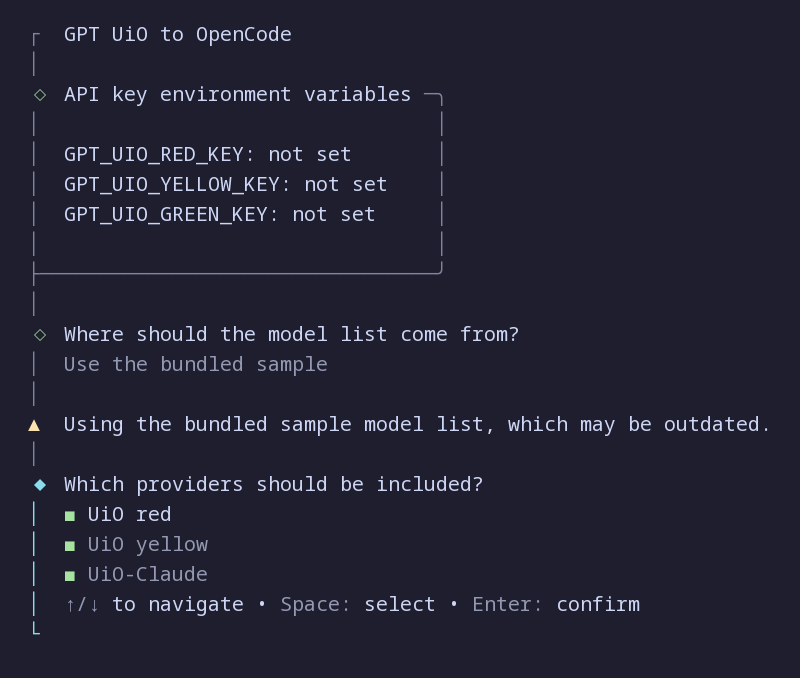

# GPT UiO to OpenCode

Dette er en TUI-app som (1) tar en liste med hvilke modeller som finnes på GPT UiO
og (2) genererer en OpenCode-config som bruker disse modellene.

Progget kjernefunksjonaliteten selv, mens testene, TUI-opplegget, og resten av
README er slop.



---

Generate an OpenCode configuration for GPT UiO's red, yellow and green
(Claude) providers.

The wizard can use your model list or a bundled sample. The sample contains only
the fields needed for conversion and may be outdated; it is not live data from
UiO.

## Get started

You need Node.js 20.12 or newer (tested with Node.js 22), npm, `make`, and a
terminal.

```sh
npm install
make run
```

To use your list, sign in to GPT UiO, open
[the `/api/user/me` endpoint](https://gpt.uio.no/api/user/me), and copy the
model array. Choose **Paste my model list** in the wizard, paste the array, and
press Tab then Enter. Copy only model data, not the full response or personal
information. The wizard validates the array before continuing. Pasted data is
used for this run and is not saved separately. Alternatively, choose **Use the
bundled sample**.

The wizard checks your API key variables, lets you choose providers and whether
to include deprecated models, then previews the output before writing. Press
Ctrl+C to cancel. Without `make`, run `npm run build && node dist/index.js`.

## API keys

Set the environment variables for the providers you want:

| Provider       | Variable             |
| -------------- | -------------------- |
| Red            | `GPT_UIO_RED_KEY`    |
| Yellow         | `GPT_UIO_YELLOW_KEY` |
| Green (Claude) | `GPT_UIO_GREEN_KEY`  |

The generated file references these variables; it does not store their values.
They must also be available to the OpenCode process, including its background
service if you use one. Missing keys produce a warning and can be set later.
The green value is used as the Claude provider's `Authorization` header.

If Claude reports a missing `Authorization` header, try `opencode --standalone`
from a terminal where `GPT_UIO_GREEN_KEY` is exported. If that works, the shared
OpenCode service may have started without the key. Restart it with
`opencode service restart` from that environment; this affects other clients
using the shared service. If the service is managed separately, ensure the key
is available in its startup environment.

## Use the config

By default, the wizard writes `processed-opencode-config.json`. OpenCode does
not load that filename automatically: merge its provider entries into your
OpenCode configuration, or choose an appropriate config path in the wizard.
Back up existing settings first: confirming an overwrite replaces the entire
file. See [OpenCode's config guide](https://opencode.ai/docs/config/) for
locations and precedence.

The generated config also disables the built-in `opencode` provider. Review
that setting if you want to keep it enabled. Excluding a provider or model here
does not remove it from other OpenCode configuration files.

Deprecated models may still be unavailable even if you include them. Costs and
token limits are not translated yet.

## Development

Run `npm run typecheck` to check types and `npm test` to build and run tests.
GitHub Actions runs the tests on Node.js 20.12 and 22 for pushes and pull requests.
